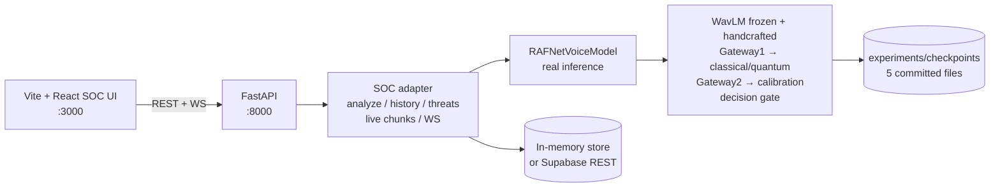

# README.md — RAFNet

AI-powered Security Operations Center for synthetic/AI-generated voice detection:
real RAFNet inference (WavLM + handcrafted → Gateway1 → classical/quantum →
Gateway2 → calibration → decision gate) behind a FastAPI backend and a Vite + React SOC UI.

## Architecture



## Roots

- Backend + ML: this repo (`src/rafnet/*`). Legacy JSON-frame API `src/rafnet/api/*`
  (`/api/v1/*`); SOC adapter `src/rafnet/soc/*` (`/api/analyze`, `/api/dashboard`,
  `/api/models`, `/api/history`, `/api/threats`, `/api/calls`, `/api/experiments`,
  `/api/live/*`, `WS /ws/live`). Docs: PROJECT_AUDIT.md, AI_MODEL_SPEC.md,
  ARCHITECTURE.md, API.md, DATABASE.md, RISK_ENGINE.md, DEPLOYMENT.md, FINAL_STATUS.md.
- Frontend: `frontend/` (Vite + React + TS, port 3000). Service
  `src/services/api.ts` calls `VITE_API_URL` with flagged mock fallback.
- Designs: `frontend/design-ref/screens/*.png` (visual reference only, gitignored).

## Quickstart — backend (SOC-only, no torch)

```bash
python -m venv .venv
.venv\Scripts\activate            # Windows (source .venv/bin/activate on Linux)
pip install -r requirements-soc.txt
cp .env.example .env              # set MODEL_CHECKPOINT_DIR, MOCK_INFERENCE=false
cd src
uvicorn rafnet.api.main:app --reload --port 8000
curl localhost:8000/api/health   # model_loaded:true only if real model loaded
```

Full ML runtime (torch CPU, production needs scikit-learn==1.9.1):
`requirements-ml.txt`. First boot downloads `microsoft/wavlm-base-plus` from HF Hub.

## Quickstart — frontend

```bash
cd frontend
cp .env.example .env.local   # VITE_API_URL=http://localhost:8000
npm install
npm run dev                  # or npm run build / npm test
```

Open Analyze → upload WAV → real `POST /api/analyze` → verdict + model
confidence + engine risk + latency. If the backend is unreachable the UI shows
the backend error (no silent fake data); a MOCK badge marks responses when the
server itself runs with `MOCK_INFERENCE=true`.

## Security defaults

- Development is anonymous-allowed (`SOC_REQUIRE_AUTH=false`); production
  (`RAFNET_ENV=production`) defaults to auth required and refuses to boot
  without Supabase keys and an explicit non-wildcard CORS origin list.
- Ownership is enforced in SQL for every analysis query: authenticated users
  see their own rows, anonymous callers see anonymous rows, and neither can
  read, clear, or receive events for the other. WebSocket clients pass the
  Supabase token as `?token=`, and event replay/streaming is per-owner.
- Legacy `/api/v1/admin/*` retraining endpoints return 403 unless
  `RAFNET_ENABLE_ADMIN=true` (local retraining only).
- CORS allows explicit methods/headers on configured origins; rate limiting
  uses the direct client IP unless `TRUST_PROXY=true` behind your load balancer.
- 4xx/5xx responses are generic (no stack traces); server logs carry details.

## Verify

```bash
# backend SOC tests (no torch needed) + lint
PYTHONPATH=src python -m pytest tests/ -q   # full suite incl. forensic layer tests
python -m ruff check src/rafnet/soc/ tests/test_soc.py scripts/ supabase/seed.py
# real-model smoke + latency profile (torch venv) + live-server E2E
PYTHONPATH=src MOCK_INFERENCE=false python scripts/test_model.py [--wav sample.wav]
PYTHONPATH=src python scripts/profile_latency.py
BASE_URL=http://localhost:8000 python scripts/e2e_probe.py
# frontend
npm test        # vitest DSP unit tests
npm run build   # tsc + vite build (SPA)
```

## Detection contract

`AnalyzeResponse`: prediction (REAL|UNCERTAIN|SYNTHETIC, model), confidence (model,
NOT risk), risk_score/risk_level/reasons (engine), model_version, processing_time_ms,
audio_duration_seconds, probabilities + gateway weights, mock flag, created_at,
plus additive `layers[]` and `verdict` (see LAYERS.md).

## Detection layers (see LAYERS.md)

Every analysis and live chunk returns four layers and a fused verdict:

- Layer 1 Spectral & Vocoder Artifacts — **heuristic** (numpy spectral proxies).
- Layer 2 Neural Detection (RAFNet) — **model** (real outputs, unchanged).
- Layer 3 Liveness & Replay — **heuristic** (pause/breath, band-limit, loop,
  noise-floor, saturation proxies + the input-path signal that flags
  virtual/loopback capture devices by label).
- Layer 4 Voice Enrollment Biometric — **unavailable** (no speaker model
  installed; never invents a similarity).

Verdict labels: HUMAN_LIVE | AI_SYNTHETIC | REPLAY_PRERECORDED |
EXTERNAL_APP_SUSPECTED | UNCERTAIN, with reasons and limitations. Fusion rules
and thresholds live in `src/rafnet/soc/layer_config.py` — documented defaults,
NOT validated. Live mode uses a rolling-window hysteresis so the session
verdict does not flicker.

## Evaluation

```
samples/human_live/*.wav        # direct mic recordings
samples/human_replayed/*.wav    # played through speakers, re-recorded
samples/tts/*.wav               # text-to-speech output
samples/voice_changed/*.wav     # voice-conversion output
.venv/Scripts/python tools/evaluate_layers.py   # -> reports/layer_eval.md + .json
```

`GET /api/evaluation` serves the report; Model Intelligence shows the measured
confusion matrix and per-layer accuracy, or "Not evaluated" when no report
exists. Replay/voice-conversion detection needs labeled data to validate —
until then treat Layers 1/3 and the verdict as unvalidated heuristics.

## Honest limitations (see AI_MODEL_SPEC.md / FINAL_STATUS.md)

Synthetic-only training with generator leakage, untrained encoders/gates, frozen WavLM,
fallback (non-quantum) branch, Phase19 n=20 all-UNCERTAIN, CPU latency over the 700 ms
target on long clips. Supabase/Auth/WS persistence planned (DATABASE.md,
supabase/README.md); current store is in-memory with the same shape.
`MOCK_INFERENCE=true` / mock UI badges are dev-only, never production.
